# Dekomposisi Sistem — Pengaduan RSUD Dr. Soetomo

**Tanggal:** 2026-10-21
**Cakupan:** seluruh komponen aplikasi (`app/`, `routes/`, `resources/views/`, `database/`, `config/`)
**Basis revisi:** analisis codebase terkini (termasuk Batch 4-7, 9.3-9.4, 11, 13-17)
**Status auth:** sengaja belum dipasang — dipisahkan di bagian [13](#13-batasan-dan-titik-ekstensi)

> Diagram memakai sintaks **Mermaid**. Di GitHub dan VS Code keduanya langsung
> tergambar; kalau editor tidak merender, tempel bloknya ke <https://mermaid.live>.

---

## 1. Konteks Sistem (Level 0)

Siapa yang berbicara dengan sistem, dan sumber daya apa yang disentuhnya.

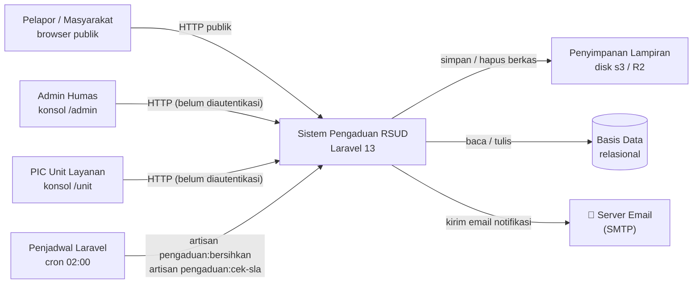

Catatan penting soal aktor:

| Aktor | Kanal masuk | Yang membatasi dia |
|-------|-------------|--------------------|
| Pelapor | `/buat-aduan`, `/lacak-tiket` | Throttle + session verifikasi kode tiket + cookie token 30 hari |
| Admin Humas | `/admin/*` | Throttle per aksi (`60/menit`); **tanpa identitas** |
| PIC Unit | `/unit/{kode}/*` | `PastikanUnitAktif` + kunci `master_unit_id` di query |
| Penjadwal | `routes/console.php` | Tidak ada |

> **SIMRS** hanya dimodelkan sebagai kolom penanda (`master_units.koneksi_simrs`,
> `master_units.disposisi`) untuk papan monitoring. Tidak ada integrasi jaringan
> ke SIMRS yang benar-benar berjalan di kode ini.

---

## 2. Peta Modul (Level 1)

Pembagian besar sistem beserta isi tiap folder.

```mermaid
flowchart TD
    Sistem["Sistem Pengaduan RSUD"]

    Sistem --> HTTP["Lapisan HTTP"]
    Sistem --> Domain["Lapisan Domain"]
    Sistem --> Penyaji["Lapisan Penyaji<br/>(app/Support)"]
    Sistem --> Tampilan["Lapisan Tampilan<br/>(Blade)"]
    Sistem --> Data["Lapisan Data<br/>(migrations)"]
    Sistem --> Infra["Infrastruktur"]

    HTTP --> H1["routes/web.php<br/>routes/console.php"]
    HTTP --> H2["Controller (11)"]
    HTTP --> H3["Middleware (5)"]

    Domain --> D1["Model (5)"]
    Domain --> D2["Enum (10)"]
    Domain --> D3["Service (4)"]
    Domain --> D4["Rule (1)"]

    Penyaji --> P1["Perhitungan SLA (1)"]
    Penyaji --> P2["Penyusun tampilan (6)"]
    Penyaji --> P3["Statistik & cache (3)"]
    Penyaji --> P4["Tindakan tiket (3)"]
    Penyaji --> P5["Master unit (1)"]
    Penyaji --> P6["Email & Notifikasi (2)"]

    Tampilan --> T1["layouts (3)"]
    Tampilan --> T2["halaman (22)"]
    Tampilan --> T3["components (5)"]

    Data --> DA1["Migrasi tabel (8)"]
    Data --> DA2["Migrasi kolom/index (10)"]

    Infra --> I1["Cache Laravel"]
    Infra --> I2["Throttle per rute"]
    Infra --> I3["Scheduler harian"]
    Infra --> I4["Storage lampiran"]
    Infra --> I5["Penanganan 429"]
    Infra --> I6["Structured Logging (JSON)"]
    Infra --> I7["Health Check Endpoints"]
    Infra --> I8["Email Queue (SMTP)"]
```

---

## 3. Alur Lapisan (Request → Response)

Urutan pemrosesan satu permintaan tulis, dari socket sampai layar.

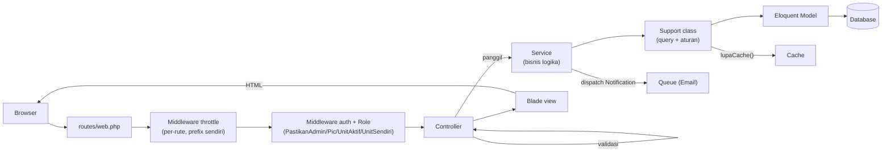

Aturan yang ditegakkan lapisan ini:

| Aturan | Konsekuensi kalau dilanggar |
|--------|-----------------------------|
| Controller tidak menulis query tampilan | Query tersebar dan tidak teruji |
| Service tidak menulis HTML | Presentasi bercampur dengan query |
| Support tidak menulis HTML | Presentasi bercampur dengan query |
| Blade tidak memanggil query | Muncul query tersembunyi di template |
| Setiap mutasi tiket memanggil `lupaCache()` | Angka dashboard basi sampai TTL habis |

---

## 4. Dekomposisi Controller

**11 Controller, 40+ method publik. Semuanya hanya mengatur alur HTTP.**

```mermaid
classDiagram
    class PengaduanController {
        +create() View
        +store(Request) RedirectResponse
        +sukses(Request) View atau RedirectResponse
        +verifikasi(Request) RedirectResponse
        +lacak(Request) View
        +kirimPesan(Request, kode) RedirectResponse
        +verifikasiEmail(Request, kode) RedirectResponse
        +kirimUlangOtp(Request, kode) RedirectResponse atau JsonResponse
    }

    class Admin_DashboardController {
        +index() View
    }

    class Admin_MonitorController {
        +index() View
    }

    class Admin_RiwayatController {
        +index(Request) View
    }

    class Admin_PengaduanController {
        +index(Request) View
        +create() View
        +store(Request) RedirectResponse
        +show(kode) View
        -cariTiket(kode) Pengaduan
        -kembali(pengaduan, pesan) RedirectResponse
    }

    class Admin_DisposisiController {
        +store(Request, kode) RedirectResponse
        +tanganiLangsung(Request, kode) RedirectResponse
    }

    class Admin_TahapController {
        +update(Request, kode) RedirectResponse
    }

    class Admin_KomunikasiController {
        +balas(Request, kode) RedirectResponse
        +koordinasi(Request, kode) RedirectResponse
        +nudge(Request, kode) RedirectResponse
        +kasusBerat(Request, kode) RedirectResponse
    }

    class Admin_ExportController {
        +pengaduan(Request) BinaryFileResponse
        +unit(Request) BinaryFileResponse
    }

    class Admin_DraftController {
        +simpan(Request, kode) RedirectResponse
        +ambil(kode) JsonResponse
    }

    class Admin_UnitController {
        +index(Request) View
        +create() View
        +store(Request) RedirectResponse
        +edit(MasterUnit) View
        +update(Request, MasterUnit) RedirectResponse
        +status(MasterUnit) RedirectResponse
    }

    class HealthCheckController {
        +index() JsonResponse
        +live() JsonResponse
        +ready() JsonResponse
    }

    class Unit_DashboardController {
        +beranda() View
        +index(MasterUnit) View
    }

    class Unit_DisposisiController {
        +index(Request, MasterUnit) View
        +show(MasterUnit, kode) View
        +arsip(Request, MasterUnit) View
        +kirim(Request, MasterUnit, kode) RedirectResponse
        +eksporDisposisiPdf(MasterUnit, kode) BinaryFileResponse
    }

    class Unit_ExportController {
        +disposisiExcel(Request, MasterUnit) BinaryFileResponse
        +arsipExcel(Request, MasterUnit) BinaryFileResponse
        +disposisiPdf(Request, MasterUnit) BinaryFileResponse
        +arsipPdf(Request, MasterUnit) BinaryFileResponse
    }

    class Unit_NotificationController {
        +tandaiDibaca(Request, MasterUnit) JsonResponse
        +tandaiSemuaDibaca(Request, MasterUnit) JsonResponse
        +daftar(Request, MasterUnit) JsonResponse
    }

    class Unit_RealTimeNotificationController {
        +index(Request, MasterUnit) JsonResponse
        +tandaiDibaca(Request, MasterUnit) JsonResponse
        +tandaiSemuaDibaca(Request, MasterUnit) JsonResponse
    }
```

Pemetaan controller → view:

| Controller | Method | View / Hasil |
|------------|--------|--------------|
| `PengaduanController` | `create` | `pengaduan.create` |
| | `store` | redirect `pengaduan.sukses` |
| | `sukses` | `pengaduan.sukses` |
| | `verifikasi` | redirect `pengaduan.lacak` |
| | `lacak` | `pengaduan.lacak` |
| | `kirimPesan` | redirect `pengaduan.lacak` |
| | `verifikasiEmail` | view `pengaduan.verifikasi-email` / redirect lacak |
| | `kirimUlangOtp` | JSON / back() |
| `Admin\DashboardController` | `index` | `admin.dashboard` |
| `Admin\MonitorController` | `index` | `admin.monitor.index` |
| `Admin\RiwayatController` | `index` | `admin.riwayat.index` |
| `Admin\PengaduanController` | `index` | `admin.pengaduan.index` |
| | `create` | `admin.pengaduan.form` |
| | `store` | redirect `admin.pengaduan.show` |
| | `show` | `admin.pengaduan.show` |
| `Admin\DisposisiController` | `store` / `tanganiLangsung` | redirect `admin.pengaduan.show` |
| `Admin\TahapController` | `update` | redirect `admin.pengaduan.show` |
| `Admin\KomunikasiController` | `balas` / `koordinasi` / `nudge` / `kasusBerat` | redirect `admin.pengaduan.show` |
| `Admin\ExportController` | `pengaduan` / `unit` | BinaryFileResponse (Excel) |
| `Admin\DraftController` | `simpan` / `ambil` | redirect / JSON |
| `Admin\UnitController` | `index` | `admin.unit.index` |
| | `create` / `edit` | `admin.unit.form` |
| | `store` / `update` / `status` | redirect `admin.unit.index` / `back()` |
| `HealthCheckController` | `index` / `live` / `ready` | JSON |
| `Unit\DashboardController` | `beranda` | `unit.beranda` |
| | `index` | `unit.dashboard` |
| `Unit\DisposisiController` | `index` | `unit.disposisi.index` |
| | `arsip` | `unit.disposisi.arsip` |
| | `show` | `unit.disposisi.show` |
| | `kirim` | redirect `unit.disposisi.show` |
| | `eksporDisposisiPdf` | BinaryFileResponse (PDF) |
| `Unit\ExportController` | `disposisiExcel` / `arsipExcel` / `disposisiPdf` / `arsipPdf` | BinaryFileResponse |
| `Unit\NotificationController` | `tandaiDibaca` / `tandaiSemuaDibaca` / `daftar` | JSON |
| `Unit\RealTimeNotificationController` | `index` / `tandaiDibaca` / `tandaiSemuaDibaca` | JSON |

---

## 5. Dekomposisi Lapisan Penyaji (`app/Support`)

16 kelas yang memegang seluruh query dan perhitungan.

```mermaid
flowchart TD
    Support["app/Support (16 kelas)"]

    Support --> A["Perhitungan SLA"]
    A --> A1["Sla<br/>standar hari kerja, zona, target"]

    Support --> B["Masuk & keluar pesan tiket"]
    B --> B1["PengaduanMasuk<br/>validasi + simpan tiket"]
    B --> B2["JawabanUnit<br/>kirim jawaban PIC"]

    Support --> C["Tindakan tiket (Service)"]
    C --> C1["DisposisiService<br/>disposisiKeUnit, tanganiLangsung"]
    C --> C2["TahapService<br/>pindahkanTahap, tujuanTersedia"]
    C --> C3["KomunikasiService<br/>balasPelapor, koordinasiUnit, nudgeUnit"]
    C --> C4["KasusBeratService<br/>tandaiKasusBerat"]

    Support --> D["Penyusun data halaman"]
    D --> D1["Dashboard (admin)"]
    D --> D2["DashboardUnit"]
    D --> D3["DaftarPengaduan"]
    D --> D4["DaftarUnit"]
    D --> D5["DetailPengaduan"]
    D --> D6["MonitorDisposisi"]
    D --> D7["RiwayatAdmin"]

    Support --> E["Statistik & cache"]
    E --> E1["StatistikDashboard"]
    E --> E2["StatistikPengaduan"]
    E --> E3["StatistikUnit"]

    Support --> F["Master data unit"]
    F --> F1["PemeliharaanUnit<br/>normalisasi, aturan, simpan, alih status"]

    Support --> G["Email & Notifikasi"]
    G --> G1["TautanNotifikasi<br/>generate URL per role"]
    G --> G2["UndanganPic<br/>token aktivasi PIC"]
```

---

## 6. Dekomposisi Enum (10)

Enum menjadi kontrak domain — menggantikan string lepas di seluruh aplikasi.

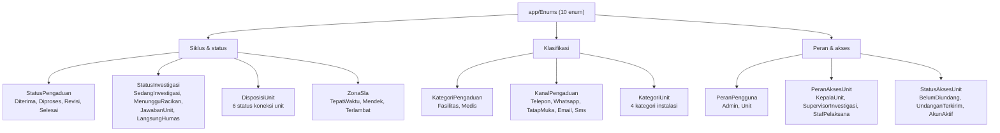

Method yang membuat enum bukan sekadar daftar nilai:

| Enum | Method perilaku |
|------|------------------|
| `StatusPengaduan` | `label`, `subStatus`, `warnaAngka`, `warnaIkon`, `badge`, `badgeAdmin`, `ikon`, `chip`, `tahap`, `tujuanBerikutnya`, `bisaBerpindahKe`, `perluAksi`, `diterima/diproses/selesai`, `dariNilai` |
| `StatusInvestigasi` | `dariPengaduan(pengaduan, unitMenjawab)`, `terapkan(Builder)`, `racikanDanArsip` |
| `DisposisiUnit` | `siap`, `ringkas`, `badge` |
| `ZonaSla` | `prioritas`, `badge`, `badgeAdmin` |
| `KanalPengaduan` | `frasa`, `ikon` |

---

## 7. Dekomposisi Data (ERD)

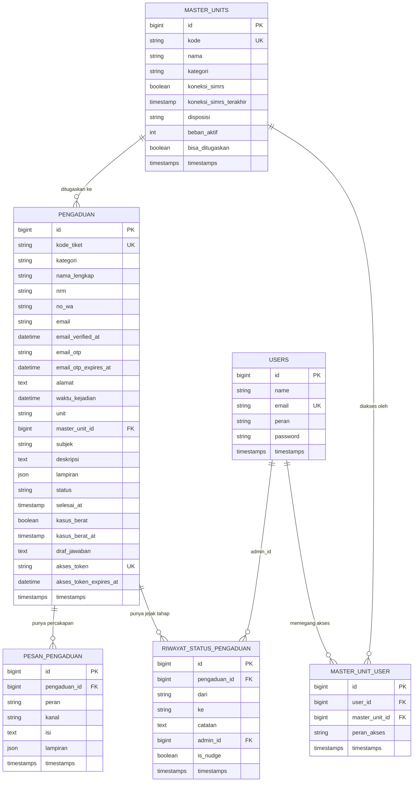

Tabel pendukung di luar domain:

| Tabel | Dipakai oleh |
|-------|--------------|
| `sessions` | Session verifikasi kode tiket (`tiket_terverifikasi`) + cookie token akses permanen |
| `cache` / `cache_locks` | `StatistikDashboard`, `StatistikPengaduan`, `StatistikUnit` |
| `jobs` / `job_batches` / `failed_jobs` | Email queue, notification queue |
| `password_reset_tokens` | Bawaan Laravel, belum dipakai |
| `notifications` | Database channel untuk notifikasi (admin + PIC) |

Index yang sudah terpasang (`pengaduan`):

| Index | Melayani |
|-------|----------|
| `status` | Agregat dashboard per tahap |
| `master_unit_id, status` | Daftar & statistik per unit |
| `kode_tiket` | Verifikasi & pencarian tiket (UNIQUE) |
| `akses_token` | Cookie token akses permanen (UNIQUE) |
| `riwayat_status_pengaduan(pengaduan_id, created_at)` | Jejak audit detail |
| `riwayat_status_pengaduan(pengaduan_id, is_nudge, created_at)` | Nudge cooldown query |
| `master_units(kode, nama)` | Pencarian master unit |

---

## 8. Dekomposisi Tampilan (Blade)

Tiga layout, 22 halaman, 5 komponen.

```mermaid
flowchart TD
    Guest["layouts/guest.blade.php"]
    Admin["admin/layout.blade.php"]
    Unit["unit/layout.blade.php"]

    Guest --> G1["maklumat/index"]
    Guest --> G2["pengaduan/create"]
    Guest --> G3["pengaduan/sukses"]
    Guest --> G4["pengaduan/lacak"]
    Guest --> G5["pengaduan/verifikasi-email"]
    Guest --> G6["errors/429"]

    Admin --> N1["admin/dashboard"]
    Admin --> N2["admin/monitor/index"]
    Admin --> N3["admin/pengaduan/index"]
    Admin --> N4["admin/pengaduan/form"]
    Admin --> N5["admin/pengaduan/show"]
    Admin --> N6["admin/unit/index"]
    Admin --> N7["admin/unit/form"]
    Admin --> N8["admin/riwayat/index"]
    Admin --> N9["admin/unit/index"]

    Unit --> U1["unit/belum-ditautkan"]
    Unit --> U2["unit/dashboard"]
    Unit --> U3["unit/disposisi/index"]
    Unit --> U4["unit/disposisi/arsip"]
    Unit --> U5["unit/disposisi/show"]
    Unit --> U6["unit/partials/notifikasi-dropdown"]

    Comp["components"] --> C1["symbol.blade.php<br/>ikon Material"]
    Comp --> C2["brand-logo.blade.php"]
    Comp --> C3["stepper-tahap.blade.php"]
    Comp --> C4["tiket-identitas.blade.php"]
    Comp --> C4["bulk-action-scripts.blade.php"]
```

Detail halaman yang memuat skrip tambahan (`@push('scripts')`):

| Halaman | Skrip tambahan |
|---------|----------------|
| `pengaduan/create` | Deskripsi kategori dinamis, pratinjau lampiran, drag-drop upload |
| `pengaduan/lacak` | Tab percakapan, form OTP, pratinjau lampiran pesan |
| `admin/pengaduan/form` | Formulir input aduan admin (interaksi kanal & lampiran) |
| `admin/pengaduan/show` | Panel workspace tiket (tab, chat, tombol aksi) |
| `admin/monitor/index` | Papan kanban disposisi |
| `admin/unit/form` | Form master unit (validasi kode unik real-time) |
| `admin/pengaduan/index` | Bulk action toolbar (via `x-bulk-action-scripts`) |
| `unit/layout` | Notifikasi dropdown + real-time polling (15 detik) |

---

## 9. Dekomposisi Rute

Grup: publik, admin, unit, export/notification. Semua endpoint tulis diberi throttle berawalan
sendiri supaya jatah antar tombol tidak saling memakan.

```mermaid
flowchart LR
    subgraph Publik["Grup publik (/)"]
        R1["GET /buat-aduan"]
        R2["POST /buat-aduan<br/>throttle 5/10m"]
        R3["GET /buat-aduan/sukses"]
        R4["GET /lacak-tiket"]
        R5["POST /lacak-tiket/verifikasi<br/>throttle 10/m"]
        R6["POST /lacak-tiket/{kode}/pesan<br/>throttle 20/m"]
        R7["GET /maklumat-prosedur"]
        R8["GET|POST /verifikasi-email/{kode}"]
        R9["POST /verifikasi-email/{kode}/kirim-ulang"]
    end

    subgraph Health["Health Check"]
        H1["GET /health"]
        H2["GET /health/live"]
        H3["GET /health/ready"]
    end

    subgraph AdminG["Grup admin (/admin)"]
        A1["GET /"]
        A2["GET /monitor"]
        A3["GET /riwayat"]
        A4["GET /pengaduan"]
        A5["GET /pengaduan/buat"]
        A6["POST /pengaduan/buat"]
        A7["GET /pengaduan/{kode}"]
        A8["POST /pengaduan/{kode}/balas"]
        A9["POST /pengaduan/{kode}/koordinasi"]
        A10["POST /pengaduan/{kode}/tahap"]
        A11["POST /pengaduan/{kode}/disposisi"]
        A12["POST /pengaduan/{kode}/tangani-langsung"]
        A13["POST /pengaduan/{kode}/kasus-berat"]
        A14["POST /pengaduan/{kode}/nudge"]
        A15["POST /pengaduan/bulk-action"]
        A16["POST /pengaduan/{kode}/draf"]
        A17["GET /pengaduan/ekspor"]
        A18["GET /unit"]
        A19["GET /unit/tambah"]
        A20["POST /unit"]
        A21["GET /unit/{unit}/ubah"]
        A21["POST /unit/{unit}/perbarui"]
        A22["POST /unit/{unit}/status"]
    end

    subgraph ExportG["Grup export (/admin/export)"]
        E1["GET /pengaduan<br/>Excel"]
        E2["GET /unit<br/>Excel"]
    end

    subgraph UnitG["Grup unit (/unit)"]
        UN1["GET /<br/>pilih unit"]
        UN2["GET /{unit}/dashboard"]
        UN3["GET /{unit}/disposisi"]
        UN4["GET /{unit}/arsip"]
        UN5["GET /{unit}/pengaduan/{kode}"]
        UN6["POST /{unit}/pengaduan/{kode}/jawaban<br/>throttle 20/m"]
        UN7["GET /{unit}/disposisi/export/excel"]
        UN8["GET /{unit}/arsip/export/excel"]
        UN9["GET /{unit}/disposisi/export/pdf"]
        UN10["GET /{unit}/arsip/export/pdf"]
        UN11["GET /{unit}/pengaduan/{kode}/ekspor/disposisi-pdf"]
        UN12["POST /{unit}/notifikasi/baca"]
        UN13["POST /{unit}/notifikasi/baca-semua"]
        UN14["GET /{unit}/notifikasi/daftar"]
        UN14["GET /{unit}/notifikasi/realtime"]
        UN15["POST /{unit}/notifikasi/realtime/baca"]
        UN16["POST /{unit}/notifikasi/realtime/baca-semua"]
    end
```

---

## 10. Alur Data Kunci

### 10.1 Buat tiket publik

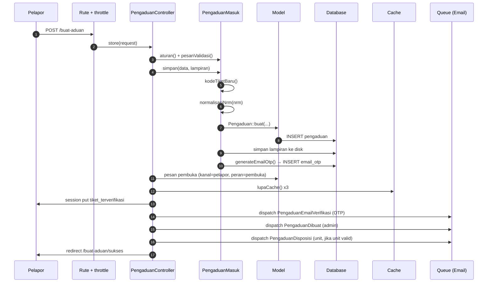

### 10.2 Disposisi tiket ke unit

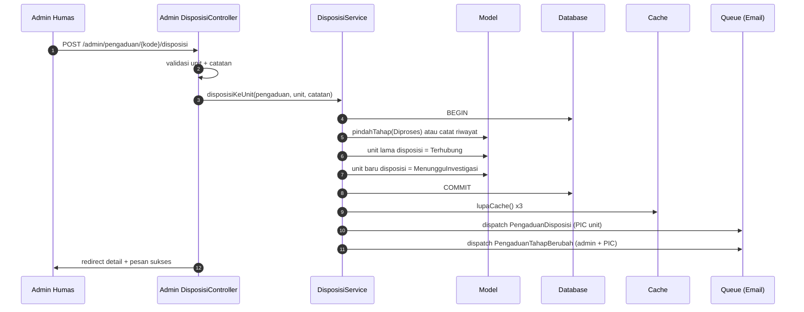

### 10.3 Unit mengirim jawaban

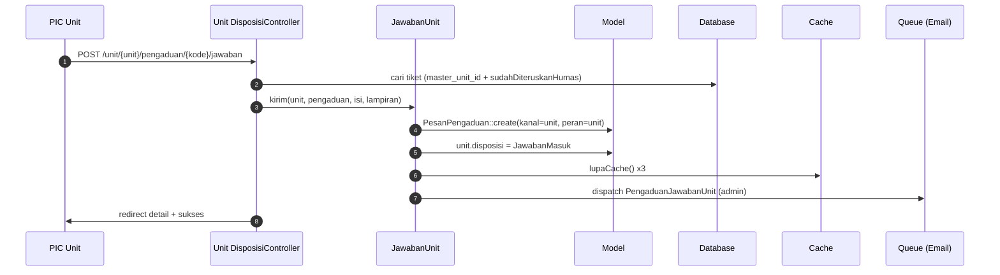

### 10.4 Verifikasi & lacak tiket

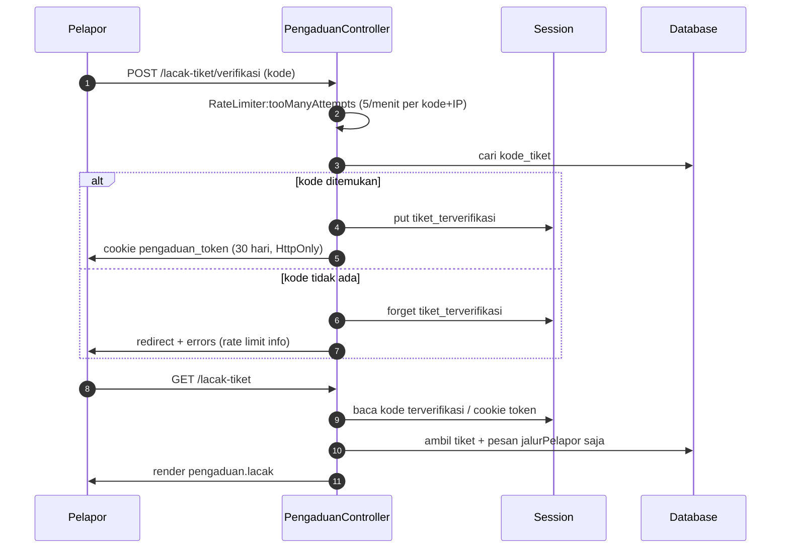

### 10.5 Retensi harian

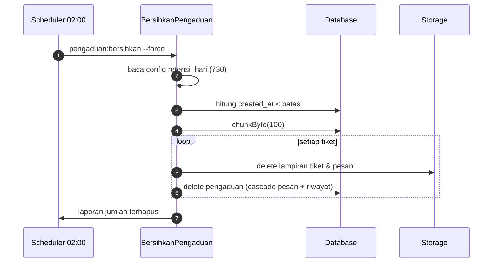

### 10.6 Cek SLA & Notifikasi Otomatis

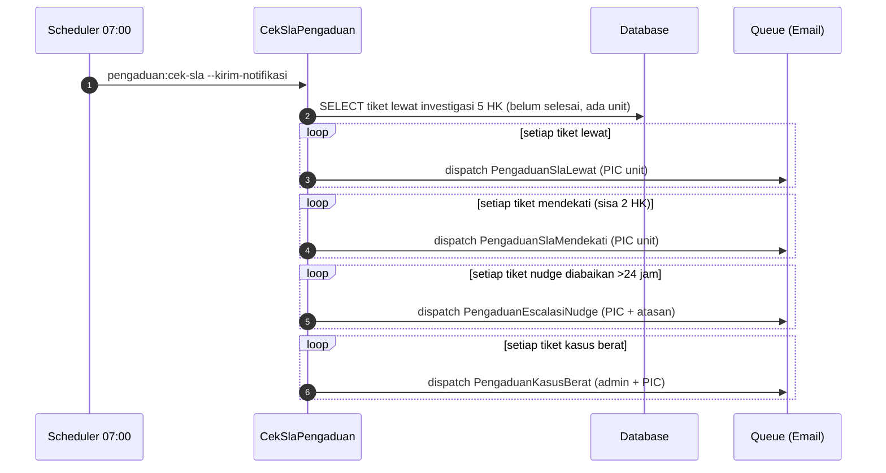

---

## 11. Dekomposisi Cache & Invalidasi

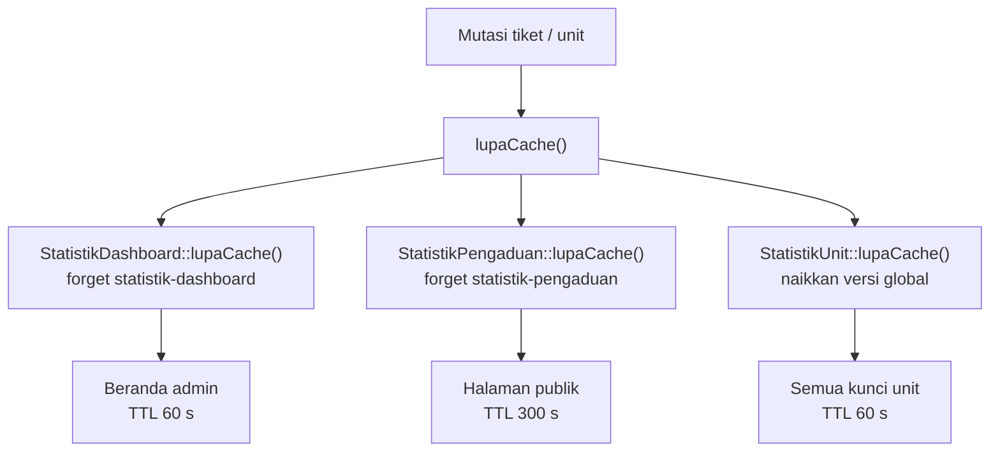

| Kelas | Kunci | TTL | Cara invalidasi |
|-------|-------|-----|-----------------|
| `StatistikDashboard` | `statistik-dashboard` | 60 s | `Cache::forget` |
| `StatistikPengaduan` | `statistik-pengaduan` | 300 s | `Cache::forget` |
| `StatistikUnit` | `statistik-unit-versi-{v}-{unit_id}` | 60 s | Naikkan `statistik-unit-versi` |

> Trik versi membuat satu operasi naik-versi membatalkan cache **semua** unit
> sekaligus, tanpa perlu query daftar unit.

---

## 12. Dekomposisi Throttle

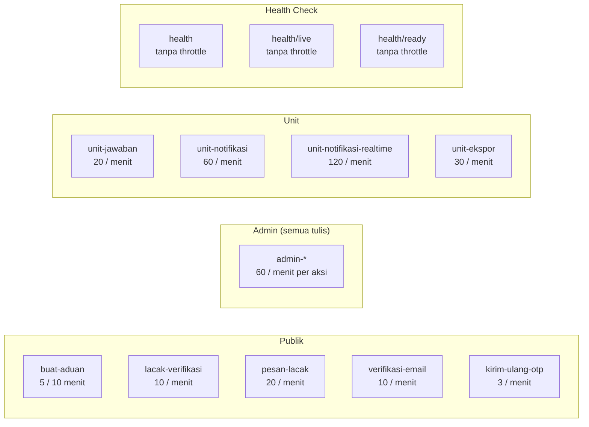

---

## 13. Batasan dan Titik Ekstensi

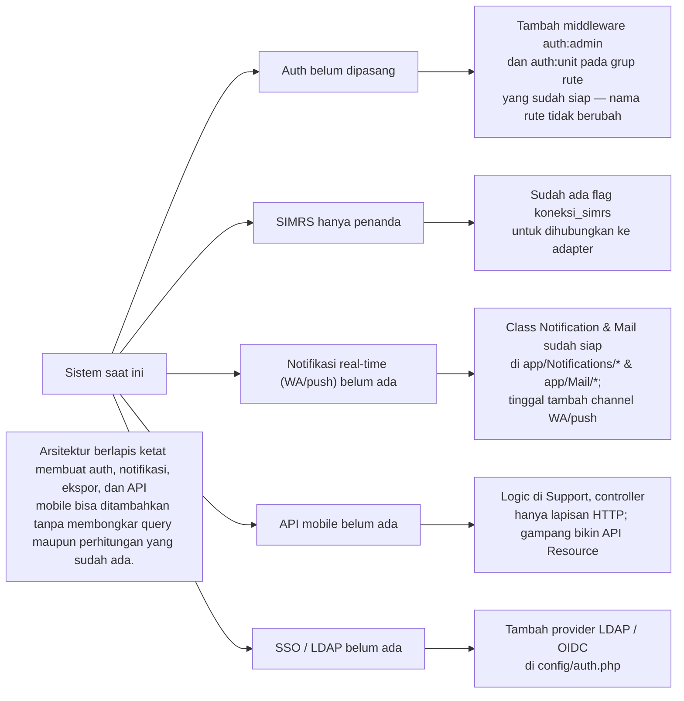

---

## Lampiran — Rekap Jumlah Komponen

| Lapisan | Jumlah |
|---------|--------|
| Controller | 11 (+3 sub-namespace: Admin\Export, Admin\Draft, Admin\Riwayat, Unit\Notification, Unit\RealTimeNotification, Unit\Export) |
| Middleware | 5 (`PastikanAdmin`, `PastikanPic`, `PastikanUnitAktif`, `PastikanUnitSendiri`, `ThrottleKeys`) |
| Model | 5 (Pengaduan, PesanPengaduan, RiwayatStatusPengaduan, MasterUnit, User) |
| Enum | 10 |
| Support | 16 |
| Service | 4 (TahapService, KomunikasiService, KasusBeratService, DisposisiService) |
| Rule | 1 (NormalizedNrmRule) |
| Notification | 14 (Dibuat, Disposisi, BalasanAdmin, JawabanUnit, KasusBerat, TahapBerubah, SlaLewat, SlaMendekati, EscalasiSla, EscalasiNudge, NudgeUnit, EmailVerifikasi, UndanganAktivasiPic, PengaduanDibuat) |
| Mail | 13 (sepadan dengan Notification + PengaduanEmailVerifikasi, UndanganAktivasiPic) |
| Export | 2 (PengaduanExport, UnitPengaduanExport) |
| Console Command | 3 (BersihkanPengaduan, CekSlaPengaduan, pengaduan:cek-sla) |
| Layout | 3 (guest, admin, unit) |
| Halaman Blade | 22 (termasuk verifikasi-email & riwayat) |
| Komponen Blade | 5 (symbol, brand-logo, stepper-tahap, tiket-identitas, bulk-action-scripts) |
| Migrasi | 17 |
| Berkas feature test | 16 (287 tests total) |
| Health Check | 3 endpoints (/health, /health/live, /health/ready) |
| Logging | JSON channel + AddContextProcessor |

---

*File ini di-ignore oleh Git & Docker (lihat `.gitignore` & `.dockerignore`).*