# DFD Level 0 — Sistem Pengaduan RSUD Dr. Soetomo

**Tanggal:** 2026-10-21  
**Scope:** Seluruh sistem (proses tunggal "Sistem Pengaduan RSUD")  
**Notasi:** Gane-Sarson (proses = bulat, entitas = persegi, data store = garis terbuka, aliran = panah)

---

## Diagram (Mermaid)

```mermaid
flowchart LR
    %% Entitas Eksternal
    Pelapor["👤 Pelapor / Masyarakat"]
    Admin["👨‍⚕️ Admin Humas"]
    PIC["🏥 PIC Unit Layanan"]
    Cron["⏰ Penjadwal Otomatis"]
    SIMRS["🏥 SIMRS (eksternal)"]
    Storage["☁️ Penyimpanan Lampiran (S3/R2)"]
    SMTP["📧 Server Email (SMTP)"]

    %% Proses Utama
    Sistem["Sistem Pengaduan RSUD"]

    %% Data Store
    DB[("Basis Data Relasional")]

    %% ALIRAN MASUK (Input) — Pelapor
    Pelapor -->|"Data Aduan Baru (POST /buat-aduan)
- Kategori: Fasilitas / Medis
- Identitas: Nama Lengkap, NRM, No WA, Email, Alamat
- Waktu Kejadian (datetime-local)
- Unit Tujuan (dropdown 12 instalasi)
- Subjek (ringkasan masalah)
- Deskripsi (kronologi ≥20 karakter)
- Lampiran: ≤5 file (JPG/PNG/PDF, ≤4 MB)
- Persetujuan: required checkbox"| Sistem

    Pelapor -->|"Verifikasi Kepemilikan (POST /lacak-tiket/verifikasi)
- Kode Tiket (ADUAN-YYYYMMDD-XXXXX)
- NRM (opsional, untuk validasi tambahan)"| Sistem

    Pelapor -->|"Balasan Pelapor (POST /lacak-tiket/{kode}/pesan)
- Isi Pesan (≤2000 karakter)
- Lampiran: ≤5 file (JPG/PNG/PDF, ≤4 MB)"| Sistem

    Pelapor -->|"Verifikasi Email (GET/POST /lacak-tiket/{kode}/verifikasi-email)
- OTP 6 digit dari email"| Sistem

    Pelapor -->|"Kirim Ulang OTP (POST /lacak-tiket/{kode}/kirim-ulang-otp)"| Sistem

    %% ALIRAN MASUK (Input) — Admin Humas
    Admin -->|"Input Aduan Non-Portal (GET/POST /admin/pengaduan/buat)
- Semua field form publik +
- Kanal Penerimaan: Telepon / WhatsApp / Tatap Muka / Email / SMS
- Catatan Petugas (pembuka)
- Lampiran"| Sistem

    Admin -->|"Disposisi ke Unit (POST /admin/pengaduan/{kode}/disposisi)
- Kode Unit Tujuan (dari MasterUnit aktif)
- Catatan Instruksi (≤500 karakter)"| Sistem

    Admin -->|"Tangani Langsung Humas (POST /admin/pengaduan/{kode}/tangani-langsung)
- Catatan Penanganan (alasan diambil alih)"| Sistem

    Admin -->|"Pindah Tahap (POST /admin/pengaduan/{kode}/tahap)
- Tahap Tujuan: Diterima / Diproses / Revisi / Selesai
- Catatan (opsional)
- Validasi transisi: Diterima→Diproses/Revisi, Diproses→Revisi/Selesai, Revisi→Diproses/Selesai, Selesai→Diproses"| Sistem

    Admin -->|"Balas ke Pelapor (POST /admin/pengaduan/{kode}/balas)
- Isi Balasan
- Lampiran (opsional)"| Sistem

    Admin -->|"Koordinasi ke Unit (POST /admin/pengaduan/{kode}/koordinasi)
- Isi Pesan Internal (tidak terlihat pelapor)
- Lampiran (opsional)"| Sistem

    Admin -->|"Tandai Kasus Berat (POST /admin/pengaduan/{kode}/kasus-berat)
- Aktif / Nonaktif (boolean)
- Catatan otomatis ke riwayat"| Sistem

    Admin -->|"Kelola Master Unit (CRUD /admin/unit)
- Tambah: Kode unik, Nama, Kategori (4), Peran PIC (3), Status Aktif, Koneksi SIMRS
- Ubah: Semua field kecuali kode
- Toggle Aktif/Nonaktif
- Hapus (soft delete via status)"| Sistem

    Admin -->|"Ekspor Data (GET /admin/export)
- Format: Excel (Laravel Excel)
- Filter: periode, status, unit, kategori"| Sistem

    Admin -->|"Aksi Massal (POST /admin/pengaduan/bulk-action)
- Disposisi massal ke unit
- Toggle kasus berat massal"| Sistem

    Admin -->|"Draf Jawaban (GET/POST /admin/pengaduan/{kode}/draf)
- Simpan / Ambil / Hapus draf jawaban"| Sistem

    %% ALIRAN MASUK (Input) — PIC Unit
    PIC -->|"Pemilihan Unit (GET /unit)
- Klik unit dari daftar 12 instalasi + beban aktif"| Sistem

    PIC -->|"Kirim Jawaban Unit (POST /unit/{unit}/pengaduan/{kode}/jawaban)
- Isi Jawaban Medis/Teknis
- Lampiran Bukti (≤5 file, JPG/PNG/PDF, ≤4 MB)
- Tidak mengubah tahap tiket (hanya catat pesan & update status disposisi unit)"| Sistem

    %% ALIRAN MASUK (Input) — Cron / Scheduler
    Cron -->|"Perintah Harian 02:00 WIB (routes/console.php)
- `pengaduan:bersihkan --force`
- Baca config `retensi_hari` (default 730 hari)
- Chunk 100 tiket per batch"| Sistem

    Cron -->|"Perintah 07:00 WIB (routes/console.php)
- `pengaduan:cek-sla --kirim-notifikasi`
- Cek SLA investigasi 5 hari kerja
- Kirim notifikasi email ke PIC unit
- Eskalasi otomatis ke atasan bila lewat berulang"| Sistem

    %% ALIRAN MASUK (Input) — SIMRS (Eksternal)
    SIMRS -.->|"Data Referensi Unit (satu arah, read-only)
- Kode & Nama Instalasi (12 unit)
- Status Koneksi (boolean + timestamp)
- Dipakai untuk papan monitoring & validasi disposisi
- Tidak ada API real-time; data diisi manual admin via Master Unit"| Sistem

    %% ALIRAN KELUAR (Output) — Pelapor
    Sistem -->|"Kode Tiket Unik (ADUAN-YYYYMMDD-XXXXX)
- Format: ADUAN- + tanggal (Ymd) + 5 huruf acak A-Z
- Unik di database (loop sampai tidak bentrok)
- Diberikan di halaman sukses & session"| Pelapor

    Sistem -->|"Halaman Lacak Tiket (GET /lacak-tiket)
- Status & Zona SLA (Tepat Waktu / Mendekati / Terlambat)
- Kronologi Peristiwa (stepper visual 4 tahap)
- Percakapan Pelapor↔Humas (jalurPelapor only)
- Lampiran Tiket & Lampiran Pesan (pratinjau gambar, tautan PDF)
- Form Kirim Balasan + Lampiran
- Form Verifikasi Email OTP
- Ringkasan Rata-rata Penyelesaian (publik)"| Pelapor

    Sistem -->|"Notifikasi Verifikasi (Session Flash)
- Berhasil: 'Verifikasi berhasil, kode tiket tersimpan'
- Gagal: 'Kode tiket tidak sesuai / sudah kadaluwarsa'
- Rate limit: 10 percobaan/menit per kode+IP"| Pelapor

    Sistem -->|"Cookie Token Akses Permanen (30 hari, HttpOnly)
- `pengaduan_token` = 64 char hex
- Auto-login kembali tanpa verifikasi ulang
- Expired: 30 hari dari generate"| Pelapor

    Sistem -->|"Pesan Pembuka Otomatis (di halaman lacak)
- 'Terima kasih telah menyampaikan pengaduan... nomor tiket {kode} pada {waktu}'
- Estimasi: maksimal 12 hari kerja
- Peran: 'pembuka' (bukan 'admin' agar tidak terbaca sudah terjawab)"| Pelapor

    Sistem -->|"Notifikasi Email Verifikasi (OTP 6 digit)
- Kirim saat tiket dibuat
- Link verifikasi + OTP di email
- Expired 15 menit, resend max 3/menit"| Pelapor

    %% ALIRAN KELUAR (Output) — Admin Humas
    Sistem -->|"Dashboard Beranda (GET /admin)
- Kartu 4 Tahap: Diterima, Diproses, Perlu Revisi, Selesai (jumlah + warna + ikon)
- KPI: Disposisi Unit + Humas Langsung, Menunggu Kelengkapan, Selesai Bulan Ini (trend)
- Banner Investigasi: Kritis (merah) / Aman (hijau) + jumlah lewat investigasi
- Status Tiket di Unit Layanan: 3 kartu (Menunggu, Sedang, Selesai) + aksi
- Daftar Butuh Tindakan Segera (paginated): 4 tiket teratas yang H-2 sebelum SLA / kasus berat
- Unit Terbebani (top 5 by beban_aktif)
- Status Koneksi Unit (SIMRS)
- Stepper Siklus Investigasi (4 pillar: H1-2, H3, H5, H6+)"| Admin

    Sistem -->|"Monitor Disposisi Kanban (GET /admin/monitor)
- 4 Kolom: Menunggu Investigasi | Sedang Investigasi | Menunggu Info Tambahan | Jawaban Masuk
- Kartu per tiket: Kode, Subjek, Unit, Hari ke-N, Zona SLA badge, Aksi cepat
- Filter: Unit, Kategori, Kata kunci
- Drag-drop belum ada (read-only view)"| Admin

    Sistem -->|"Daftar Pengaduan Tabel (GET /admin/pengaduan)
- Tab: Semua / Diterima / Diproses / Revisi / Selesai
- Filter: Status, Investigasi (lewat/aman), Unit, Kategori, Kata Kunci
- Kolom: Kode, Pelapor, NRM, Unit, Tahap, Investigasi (HK), SLA (Hari ke/sisa), Aksi
- Paginasi: 10 / 25 / 50 / 100 per halaman
- Export Excel tersedia
- Aksi massal: Disposisi massal, Toggle kasus berat massal"| Admin

    Sistem -->|"Detail Tiket Workspace (GET /admin/pengaduan/{kode})
- Identitas: Pelapor, NRM, WA, Email, Alamat, Waktu Kejadian, Unit, Kategori
- Pilar 1: Kronologi (stepper 4 tahap SPM + indikator hari ke-N)
- Pilar 2: Lampiran (grid pratinjau + unduh)
- Pilar 3: Jejak Audit (riwayat status + admin + catatan + waktu)
- Pilar 4: SLA (target, sisa HK, zona, progres %)
- Panel Percakapan Pelapor (kanan): chat 2 arah + lampiran
- Panel Koordinasi Humas↔Unit (kiri): internal chat + lampiran
- Panel Tindakan: Disposisi, Tahap, Balas Pelapor, Koordinasi, Kasus Berat, Nudge
- Tombol Nudge: POST ke /admin/pengaduan/{kode}/nudge (manual follow-up unit)
- Tombol Aksi Massal: Disposisi massal, Toggle kasus berat"| Admin

    Sistem -->|"Halaman Input Aduan Admin (GET/POST /admin/pengaduan/buat)
- Form identik publik + field Kanal Penerimaan (5 opsi)
- Dropdown Unit dari MasterUnit (hanya aktif & bisa ditugaskan)
- Validasi sama: PengaduanMasuk::aturan()"| Admin

    Sistem -->|"Master Data Unit (GET/POST /admin/unit)
- Tabel: Kode, Nama, Kategori, PIC, Status Aktif, Koneksi SIMRS, Beban Aktif
- Kartu Distribusi Kategori (4 warna)
- Form Tambah/Ubah: validasi kode unik (regex ^[A-Z]{2,4}-[0-9]{2}$)
- Toggle Aktif → update disposisi status & cache"| Admin

    Sistem -->|"Ekspor Admin (GET /admin/pengaduan/ekspor)
- Format Excel (Laravel Excel)
- Filter: periode, status, unit, kategori"| Admin

    Sistem -->|"Ekspor Lembar Disposisi (GET /admin/pengaduan/{kode}/ekspor/disposisi-pdf)
- Format PDF (dompdf)
- Template: exports/lembar-disposisi.blade.php"| Admin

    Sistem -->|"Preview Lembar Disposisi (GET /admin/pengaduan/{kode}/ekspor/disposisi-preview)
- Preview HTML sebelum download PDF"| Admin

    Sistem -->|"Draf Jawaban (GET/POST /admin/pengaduan/{kode}/draf)
- Simpan / Ambil / Hapus draf jawaban admin
- Auto-save via AJAX"| Admin

    Sistem -->|"Aksi Massal (POST /admin/pengaduan/bulk-action)
- Disposisi massal ke unit
- Toggle kasus berat massal"| Admin

    Sistem -->|"Health Check Endpoints
- GET /health (full check: DB, cache, Redis, storage)
- GET /health/live (liveness probe)
- GET /health/ready (readiness probe)"| Admin

    %% ALIRAN KELUAR (Output) — PIC Unit
    Sistem -->|"Pemilih Unit (GET /unit)
- Daftar 12 unit + Beban Aktif (beban_aktif)
- Kartu: Nama, Kategori, Beban, Status Koneksi SIMRS"| PIC

    Sistem -->|"Dashboard Unit (GET /unit/{unit}/dashboard)
- Ringkasan per Tahap: Masuk, Diproses, Selesai (jumlah + warna)
- KPI: Aktif, Terlambat, Mendekati, Rata-rata Hari Kerja
- 2 Tiket Mendesak: lewat investigasi 5 HK (badge merah)
- 8 Tiket Terbaru: kode, subjek, status, hari ke-N
- Stepper SLA per tiket (visual 4 pilar)"| PIC

    Sistem -->|"Daftar Disposisi Unit (GET /unit/{unit}/disposisi)
- Tab: Masuk (MenungguInvestigasi) | Diproses (SedangInvestigasi/JawabanMasuk) | Arsip (Selesai/Terhubung)
- Hanya tiket dengan master_unit_id = unit ini
- Filter: Status, Kata Kunci
- Paginasi 10/25/50/100"| PIC

    Sistem -->|"Detail Disposisi Unit (GET /unit/{unit}/pengaduan/{kode})
- Kartu 1: Kronologi Pelapor + Lampiran Tiket (read-only)
- Chat Koordinasi Humas↔Unit (dua arah, kanal=unit, peran=admin/unit)
- Form Kirim Jawaban ke Humas (isi + lampiran → update disposisi=JawabanMasuk)
- Panel Tindakan Mati (disabled): Cetak, PDF, Excel, Eskalasi, TTD Digital
- Ekspor Lembar Disposisi PDF"| PIC

    Sistem -->|"Arsip Disposisi Unit (GET /unit/{unit}/arsip)
- Hanya tiket status Selesai milik unit ini
- Saring & Paginasi sama daftar disposisi"| PIC

    Sistem -->|"Ekspor Unit (GET /unit/{unit}/disposisi/export/excel, /arsip/export/excel)
- Format Excel (Maatwebsite Excel)
- Kolom: Kode, Tanggal, Pelapor, NRM, Kategori, Unit, Subjek, Status, Sisa SLA, Target SLA"| PIC

    Sistem -->|"Ekspor PDF Unit (GET /unit/{unit}/disposisi/export/pdf, /arsip/export/pdf)
- Format PDF (dompdf)
- Template: exports/unit-daftar.blade.php
- Landscape A4"| PIC

    Sistem -->|"Ekspor Lembar Disposisi PDF (GET /unit/{unit}/pengaduan/{kode}/ekspor/disposisi-pdf)
- Template: exports/lembar-disposisi.blade.php
- A4 Portrait"| PIC

    %% ALIRAN KELUAR (Output) — Cron
    Sistem -->|"Laporan Penghapusan Harian (Console Output)
- Jumlah tiket terhapus
- Jumlah berkas lampiran terhapus (disk)
- Jumlah tiket belum selesai ikut terhapus (peringatan)"| Cron

    %% ALIRAN KELUAR (Output) — Storage
    Sistem -->|"Simpan Berkas Lampiran
- Path: lampiran/{random}/{filename}
- Disk: config('pengaduan.disk_lampiran') → env('DISK_LAMPIRAN', 'public')
- Return: path relatif untuk disimpan di JSON lampiran"| Storage

    Sistem -->|"Hapus Berkas Lampiran (Retensi)
- Loop tiket lama → delete dari disk
- Return: jumlah terhapus"| Storage

    %% ALIRAN KELUAR (Output) — Database
    Sistem -->|"Tulis & Baca Seluruh Entitas
- pengaduan (INSERT, UPDATE status/tahap/kasus_berat/master_unit_id/draf_jawaban, DELETE cascade)
- pesan_pengaduan (INSERT, UPDATE, DELETE cascade)
- riwayat_status_pengaduan (INSERT pada created, pindahTahap, tandaiKasusBerat)
- master_units (CRUD admin, UPDATE disposisi/koneksi sistem)
- users (auth nanti, riwayat admin_id)
- master_unit_user (pivot PIC↔Unit, peran_akses 3 level)
- cache: statistik-dashboard (60s), statistik-pengaduan (300s), statistik-unit-versi-{v}-{id} (60s)
- sessions: tiket_terverifikasi (kode tiket)
- notifications (database channel untuk notifikasi admin + PIC)"| DB

    %% ALIRAN KELUAR (Output) — Email (SMTP)
    Sistem -->|"Notifikasi Email Otomatis (Queue)
- PengaduanDibuat → Admin (tiket baru)
- PengaduanDisposisi → PIC Unit (disposisi)
- PengaduanTahapBerubah → Admin + PIC (tahap berubah)
- PengaduanBalasanAdmin → Pelapor (balasan admin)
- PengaduanSlaMendekati → PIC Unit (sisa 2 HK)
- PengaduanSlaLewat → PIC Unit (lewat 5 HK)
- PengaduanNudgeUnit → PIC Unit (nudge manual)
- PengaduanKasusBerat → Admin + PIC (toggle kasus berat)
- PengaduanEscalasiSla → PIC + Atasan (lewat 5 HK berulang)
- PengaduanEscalasiNudge → PIC + Atasan (nudge diabaikan >24 jam)
- PengaduanJawabanUnit → Admin (jawaban unit masuk)
- PengaduanEmailVerifikasi → Pelapor (OTP 6 digit)
- UndanganAktivasiPic → PIC (token aktivasi 24 jam)"| SMTP

    %% ALIRAN MASUK (Input) — Email (SMTP)
    SMTP -.->|"Email Bounce / Complaint (opsional)
- Bisa diimplementasikan via webhook
- Belum diimplementasikan"| Sistem
```

---

## Tabel Ringkasan Input/Output per Role (Detail Lengkap)

| Role | Input (Masuk ke Sistem) | Output (Keluar dari Sistem) |
|------|--------------------------|-----------------------------|
| **Pelapor** | 1. Form aduan lengkap + lampiran (12 field + 5 file max) 2. Kode tiket + NRM (verifikasi kepemilikan) 3. Balasan pesan + lampiran opsional (chat 2 arah) 4. OTP 6 digit (verifikasi email) 5. Request kirim ulang OTP | 1. Kode tiket unik (ADUAN-YYYYMMDD-XXXXX) 2. Halaman lacak: status, zona SLA, kronologi 4 tahap, chat pelapor↔humas, lampiran tiket & pesan 3. Notifikasi verifikasi (berhasil/gagal + rate limit info) 4. Cookie token akses permanen (30 hari, HttpOnly) 5. Pesan pembuka otomatis (peran=pembuka) 6. Form verifikasi email OTP 6. Ringkasan rata-rata penyelesaian publik 7. Notifikasi email verifikasi (OTP 6 digit) |
| **Admin Humas** | 1. Form aduan non-portal: semua field publik + kanal (5 opsi) + catatan petugas 2. Disposisi: kode unit tujuan + instruksi (≤500 chr) 3. Tangani langsung: catatan alasan 4. Pindah tahap: tujuan (4 tahap, validasi transisi) + catatan 5. Balas pelapor: isi + lampiran 6. Koordinasi unit: isi internal + lampiran (tidak terlihat pelapor) 7. Kasus berat: toggle aktif/nonaktif 8. Master Unit CRUD: kode, nama, kategori(4), peran PIC(3), aktif, koneksi SIMRS 8. Ekspor: filter periode/status/unit/kategori → Excel 9. Aksi massal: Disposisi massal, Toggle kasus berat massal 10. Draf jawaban: simpan/ambil/hapus 11. Health check endpoints | 1. Dashboard beranda: 4 kartu tahap + KPI + banner investigasi + 3 kartu unit + daftar butuh tindakan (4) + unit terbebani + status koneksi + stepper siklus 2. Monitor Kanban: 4 kolom (Menunggu/Sedang/Menunggu Info/Jawaban) + kartu tiket + filter 3. Daftar tabel: 5 tab + 6 filter + 7 kolom + paginasi 10-100 + export + aksi massal 4. Detail workspace: 4 pilar (kronologi, lampiran, audit, SLA) + 3 panel chat + 6 tombol aksi + aksi massal 4. Form input aduan admin (identik publik + kanal) 5. Master data unit: tabel + 4 kartu kategori + form validasi kode unik + toggle aktif 6. Laporan ekspor Excel 5. Notifikasi email ke admin (tiket baru, balasan, tahap berubah, kasus berat, jawaban unit) |
| **PIC Unit** | 1. Pemilihan unit dari daftar (klik kartu unit) 2. Kirim jawaban unit: isi medis/teknis + lampiran bukti (≤5 file) 3. Navigasi tab: Masuk / Diproses / Arsip 4. Filter daftar disposisi 5. Tandai notifikasi dibaca (satu / semua) 6. Polling real-time (GET /notifikasi/realtime) | 1. Pemilih unit: 12 kartu + beban aktif + status koneksi SIMRS 2. Dashboard unit: 3 kartu tahap + 4 KPI + 2 tiket mendesak + 8 tiket terbaru + stepper SLA per tiket 2. Daftar disposisi: 3 tab (Masuk/Diproses/Arsip) filter + paginasi 3. Detail disposisi: kronologi pelapor + chat koordinasi 2 arah + form jawaban + 5 tombol mati 3. Arsip: hanya status Selesai milik unit 4. Ekspor: Excel/PDF (disposisi & arsip) + Lembar Disposisi PDF per tiket 5. Notifikasi email (SLA mendekati/lewat, nudge, eskalasi, kasus berat) |
| **Penjadwal (Cron)** | 1. Perintah `pengaduan:bersihkan --force` harian 02:00 WIB 2. Perintah `pengaduan:cek-sla --kirim-notifikasi` harian 07:00 WIB 3. Config `retensi_hari` (730 default) 4. Config `sla.investigasi_hari_kerja` (5 hari kerja) | 1. Laporan console: jumlah tiket terhapus, berkas terhapus, tiket belum selesai terhapus 2. Notifikasi email SLA ke PIC unit (mendekati/lewat) 3. Eskalasi otomatis ke atasan (lewat berulang, nudge diabaikan) |
| **SIMRS (Eksternal)** | 1. Data referensi unit: kode, nama, status koneksi (manual entry admin) — *read-only, tidak ada API nyata* | — (tidak ada output ke SIMRS; sistem hanya konsumsi data referensi) |
| **Penyimpanan (S3/R2/Local)** | 1. Simpan berkas lampiran tiket & pesan (path relatif) 2. Hapus berkas saat retensi / delete tiket | 1. URL signed / path berkas untuk pratinjau & unduh 2. Jumlah berkas terhapus (laporan cron) |
| **Server Email (SMTP)** | — (input dari sistem via queue) | 1. 14 jenis notifikasi email otomatis ke admin, PIC, pelapor 2. Queue dengan retry (tries=3, backoff=5) |
| **Health Check Client** | — (read-only) | 1. GET /health (full: DB, cache, Redis, storage, latency) 2. GET /health/live (liveness probe) 3. GET /health/ready (readiness probe) |

---

## Data Store (Basis Data) — Entitas & Aliran Detail

| Tabel | Ditulis Oleh | Dibaca Oleh | Catatan |
|-------|--------------|-------------|---------|
| `pengaduan` | Pelapor (store), Admin (store, update status/tahap/kasus_berat/master_unit_id/draf_jawaban), Cron (DELETE cascade) | Semua role (daftar, detail, statistik, dashboard) | PK `id`, UK `kode_tiket`, FK `master_unit_id`, JSON `lampiran`, enum `status`, `kasus_berat` boolean, `draf_jawaban` text |
| `pesan_pengaduan` | Pelapor (kirim, kanal=pelapor, peran=pelapor/pembuka), Admin (balas pelapor peran=admin kanal=pelapor, koordinasi peran=admin kanal=unit), PIC (jawab peran=unit kanal=unit), Cron (DELETE cascade) | Pelapor (scope `jalurPelapor`: kanal=pelapor), Admin (semua), PIC (scope `jalurUnit`: kanal=unit) | Kolom `kanal` (pelapor/unit), `peran` (pembuka/pelapor/admin/unit), `lampiran` JSON |
| `riwayat_status_pengaduan` | Admin (pindahTahap, tandaiKasusBerat), Sistem (event `created` → dari=null, ke=status awal) | Detail tiket (jejak audit), Dashboard (statistik) | `admin_id` nullable (belum auth), `dari`/`ke` enum StatusPengaduan, `is_nudge` boolean (nudge cooldown) |
| `master_units` | Admin (CRUD), Sistem (UPDATE `disposisi` enum 6 status, `koneksi_simrs` boolean, `koneksi_simrs_terakhir`, `beban_aktif` counter) | Semua (dropdown, dashboard, filter, statistik, validasi disposisi) | `disposisi`: MenungguInvestigasi, SedangInvestigasi, MenungguRacikan, JawabanMasuk, Terhubung, Eskalasi |
| `users` | (Belum ada registrasi UI) | Auth nanti, riwayat `admin_id`, relasi PIC | Kolom `peran` enum: admin, unit |
| `master_unit_user` | (Belum ada UI manajemen) | Auth nanti, relasi PIC↔Unit, middleware `PastikanUnitAktif` | Pivot `peran_akses`: KepalaUnit, SupervisorInvestigasi, StafPelaksana |
| `cache` | `StatistikDashboard::lupaCache()` (forget), `StatistikPengaduan::lupaCache()` (forget), `StatistikUnit::lupaCache()` (naik versi global) | Dashboard, Daftar, Monitor, Detail (via Support classes) | 3 kunci: `statistik-dashboard` (60s), `statistik-pengaduan` (300s), `statistik-unit-versi-{v}-{id}` (60s) |
| `sessions` | Pelapor (verifikasi tiket → put `tiket_terverifikasi`) | Pelapor (lacak, kirim pesan → read `tiket_terverifikasi`) | Kunci `tiket_terverifikasi` = array `['kode' => 'ADUAN-...']` |
| `notifications` | Semua proses yang dispatch Notification | Admin (database channel), PIC (database channel), Email (mail channel) | `type`, `notifiable_type`, `notifiable_id`, `data` JSON |
| `notifications` (PIC) | Proses 10.0 | PIC Unit (database channel) | Tandai dibaca, real-time polling |
| `notifications` (Admin) | Proses 5.0, 6.0 | Admin Humas (database channel) | Riwayat aksi admin |

---

## Batasan DFD Level 0

- **Satu proses utama** ("Sistem Pengaduan RSUD") — detail dekomposisi ke Level 1 ada di `dekomposisi.md` bagian 2, 5, 8, 10.
- **SIMRS** digambar sebagai entitas eksternal *read-only* karena saat ini hanya data referensi statis di `master_units`; tidak ada sinkronisasi real-time.
- **Auth** belum dipasang — aliran identitas (login, session user) belum ada; saat ini hanya session verifikasi kode tiket untuk pelapor.
- **Notifikasi real-time** (email, WA, push) — email sudah ada via queue (14 jenis); WA/push belum ada.
- **Ekspor/Cetak** (PDF, Excel, TTD digital) — Excel sudah tersedia di admin & unit; PDF lembar disposisi sudah ada; TTD digital belum.
- **Rate limiting** diterapkan per-rute dengan prefix sendiri (publik: 5/10m buat, 10/m verifikasi, 20/m pesan; admin: 60/m; unit: 20/m jawaban, 120/m polling).
- **Structured Logging** — JSON channel dengan `AddContextProcessor` (request_id, user, trace_id, kode_tiket, unit_kode).
- **Health Check** — 3 endpoint: `/health` (full), `/health/live` (liveness), `/health/ready` (readiness).
- **Structured Logging** — JSON channel dengan `AddContextProcessor` (request_id, user, trace_id, kode_tiket, unit_kode).
- **Controller Split** — `Admin\PengaduanController` dipisah jadi 4: `PengaduanController`, `DisposisiController`, `TahapController`, `KomunikasiController`.
- **Controller Split** — `Admin\PengaduanController` dipisah jadi 4: `PengaduanController`, `DisposisiController`, `TahapController`, `KomunikasiController`.

---

*File ini di-ignore oleh Git & Docker (lihat `.gitignore` & `.dockerignore`).*