# DFD Level 1 — Sistem Pengaduan RSUD Dr. Soetomo

**Tanggal:** 2026-10-16
**Scope:** Dekomposisi proses tunggal Level 0 menjadi 10 sub-proses
**Notasi:** Gane-Sarson (proses = bulat, entitas = persegi, data store = garis terbuka, aliran = panah)
**Basis:** Rute terkini (`routes/web.php`, `routes/console.php`), controller, support class, dan model yang ada di codebase

---

## Peta Sub-Proses

| Kode | Nama Proses | Pelaku | Controller / Command |
|------|-------------|--------|---------------------|
| **1.0** | Pendaftaran Aduan Publik | Pelapor | `PengaduanController@create/store/sukses` |
| **2.0** | Verifikasi & Pelacakan Tiket | Pelapor | `PengaduanController@verifikasi/lacak` |
| **3.0** | Verifikasi Email OTP | Pelapor | `PengaduanController@verifikasiEmail/kirimUlangOtp` |
| **4.0** | Percakapan Pelapor | Pelapor | `PengaduanController@kirimPesan` |
| **5.0** | Pengelolaan Tiket Humas | Admin Humas | `Admin\PengaduanController` (semua method) |
| **6.0** | Monitoring & Konsol Admin | Admin Humas | `Admin\DashboardController`, `Admin\MonitorController`, `Admin\RiwayatController` |
| **7.0** | Manajemen Master Unit | Admin Humas | `Admin\UnitController` |
| **8.0** | Penyajian Dashboard & Disposisi Unit | PIC Unit | `Unit\DashboardController`, `Unit\DisposisiController` |
| **9.0** | Retensi & Monitoring SLA Otomatis | Scheduler | `pengaduan:bersihkan`, `pengaduan:cek-sla` |
| **10.0** | Notifikasi Unit & Real-Time | PIC Unit | `Unit\NotificationController`, `Unit\RealTimeNotificationController` |

---

## Diagram Utama (Mermaid)

```mermaid
flowchart LR
    %% ===== ENTI EKSTERNAL =====
    Pelapor["👤 Pelapor"]
    Admin["👨‍⚕️ Admin Humas"]
    PIC["🏥 PIC Unit Layanan"]
    Scheduler["⏰ Scheduler<br/>(Laravel)"]
    SIMRS["🏥 SIMRS<br/>(read-only)"]
    Storage["☁️ Penyimpanan<br/>(S3/R2)"]

    %% ===== SUB-PROSES =====
    P1["1.0<br/>Pendaftaran<br/>Aduan Publik"]
    P2["2.0<br/>Verifikasi &<br/>Pelacakan Tiket"]
    P3["3.0<br/>Verifikasi<br/>Email OTP"]
    P4["4.0<br/>Percakapan<br/>Pelapor"]
    P5["5.0<br/>Pengelolaan<br/>Tiket Humas"]
    P6["6.0<br/>Monitoring &<br/>Konsol Admin"]
    P7["7.0<br/>Manajemen<br/>Master Unit"]
    P8["8.0<br/>Dashboard &<br/>Disposisi Unit"]
    P9["9.0<br/>Retensi &<br/>Monitoring SLA"]
    P10["10.0<br/>Notifikasi<br/>Unit & Real-Time"]

    %% ===== DATA STORE =====
    DS1[("pengaduan")]
    DS2[("pesan_pengaduan")]
    DS3[("riwayat_status_pengaduan")]
    DS4[("master_units")]
    DS5[("users / master_unit_user")]
    DS6[("sessions")]
    DS7[("cache")]
    DS8[("config/pengaduan.php")]

    %% ===== ALIRAN: PELAPOR → PROSES =====
    Pelapor -->|"Form aduan lengkap + lampiran<br/>(POST /buat-aduan, throttle 5/10m)"| P1
    Pelapor -->|"Kode tiket + NRM<br/>(POST /lacak-tiket/verifikasi, throttle 10/m)"| P2
    Pelapor -->|"OTP 6 digit + request kirim ulang<br/>(POST /verifikasi-email/{kode})"| P3
    Pelapor -->|"Isi pesan + lampiran opsional<br/>(POST /lacak-tiket/{kode}/pesan, throttle 20/m)"| P4

    %% ===== ALIRAN: ADMIN → PROSES =====
    Admin -->|"Aduan non-portal: form + kanal + catatan petugas<br/>(POST /admin/pengaduan/buat, throttle 60/m)"| P5
    Admin -->|"Disposisi / Tahap / Balas / Koordinasi / Kasus Berat / Nudge / Draf / Bulk<br/>(POST /admin/pengaduan/{kode}/*, throttle 60/m)"| P5
    Admin -->|"Filter, pencarian, paginasi<br/>(GET /admin, /admin/monitor, /admin/riwayat)"| P6
    Admin -->|"CRUD unit + toggle aktif<br/>(POST /admin/unit*, throttle 60/m)"| P7

    %% ===== ALIRAN: PIC → PROSES =====
    PIC -->|"Pilih unit dari daftar<br/>(GET /unit)"| P8
    PIC -->|"Isi jawaban medis/teknis + lampiran<br/>(POST /unit/{unit}/pengaduan/{kode}/jawaban, throttle 20/m)"| P8
    PIC -->|"Tandai notifikasi dibaca<br/>(POST /unit/{unit}/notifikasi/baca, throttle 60/m)"| P10

    %% ===== ALIRAN: SCHEDULER → PROSES =====
    Scheduler -->|"pengaduan:bersihkan --force<br/>dailyAt 02:00"| P9
    Scheduler -->|"pengaduan:cek-sla --kirim-notifikasi<br/>dailyAt 07:00"| P9

    %% ===== ALIRAN: SIMRS → PROSES =====
    SIMRS -.->|"Referensi unit (manual entry via Master Unit)<br/>tidak ada API real-time"| P7

    %% ===== ALIRAN: PROSES → PELAPOR =====
    P1 -->|"Kode tiket unik (ADUAN-YYYYMMDD-XXXXX)<br/>+ halaman sukses"| Pelapor
    P2 -->|"Halaman lacak: status, zona SLA,<br/>kronologi, chat, lampiran"| Pelapor
    P3 -->|"Status verifikasi email<br/>(berhasil / gagal / kadaluwarsa)"| Pelapor

    %% ===== ALIRAN: PROSES → ADMIN =====
    P5 -->|"Detail tiket workspace: 4 pilar + 3 panel chat + 6 tombol aksi<br/>+ ekspor Excel / PDF / preview disposisi"| Admin
    P6 -->|"Dashboard beranda: 4 kartu tahap + KPI + banner + daftar tindakan<br/>+ Monitor Kanban 4 kolom + Riwayat aksi admin"| Admin
    P7 -->|"Tabel unit + KPI beban + form CRUD + toggle aktif"| Admin

    %% ===== ALIRAN: PROSES → PIC =====
    P8 -->|"Pemilih unit + Dashboard unit + Daftar disposisi (3 tab)<br/>+ Detail disposisi + ekspor Excel/PDF"| PIC

    %% ===== ALIRAN: PROSES → SCHEDULER =====
    P9 -->|"Laporan penghapusan: jumlah tiket, berkas,<br/>tiket belum selesai terhapus"| Scheduler

    %% ===== ALIRAN: PROSES → STORAGE =====
    P1 -->|"Simpan berkas lampiran tiket"| Storage
    P4 -->|"Simpan berkas lampiran pesan"| Storage
    P5 -->|"Simpan berkas lampiran admin"| Storage
    P8 -->|"Simpan berkas lampiran unit"| Storage
    P9 -->|"Hapus berkas lampiran (retensi 730 hari)"| Storage

    %% ===== ALIRAN: PROSES → DATABASE =====
    P1 -->|"INSERT pengaduan, INSERT pesan_pembuka,<br/>INSERT riwayat(awal), UPDATE cache"| DS1
    P1 -->|"INSERT pesan (peran=pembuka)"| DS2
    P1 -->|"INSERT riwayat (dari=null, ke=Diterima)"| DS3
    P1 -->|"INSERT session (tiket_terverifikasi)"| DS6
    P1 -->|"lupaCache() x3"| DS7

    P2 -->|"SELECT pengaduan (kode_tiket, master_unit_id)"| DS1
    P2 -->|"SELECT pesan (jalurPelapor)"| DS2
    P2 -->|"UPDATE session, INSERT cookie token"| DS6

    P3 -->|"UPDATE pengaduan (email_verified_at,<br/>email_otp=NULL)"| DS1

    P4 -->|"SELECT pengaduan (kode_tiket)"| DS1
    P4 -->|"INSERT pesan (peran=pelapor, kanal=pelapor)"| DS2

    P5 -->|"SELECT/UPDATE pengaduan (status, master_unit_id,<br/>kasus_berat, draf_jawaban, lampiran)"| DS1
    P5 -->|"INSERT pesan (balas peran=admin,<br/>koordinasi peran=admin kanal=unit)"| DS2
    P5 -->|"INSERT riwayat (pindahTahap, kasusBerat)"| DS3
    P5 -->|"SELECT master_units (validasi bisaDitugaskan)"| DS4
    P5 -->|"SELECT users (notifikasi admin)"| DS5
    P5 -->|"lupaCache() x3"| DS7

    P6 -->|"SELECT pengaduan (agregat, filter, paginasi)"| DS1
    P6 -->|"SELECT riwayat_status_pengaduan"| DS3
    P6 -->|"SELECT master_units (beban, koneksi)"| DS4
    P6 -->|"baca cache (statistik-dashboard 60s)"| DS7

    P7 -->|"SELECT/INSERT/UPDATE/DELETE master_units"| DS4
    P7 -->|"lupaCache()"| DS7

    P8 -->|"SELECT pengaduan (master_unit_id = unit ini,<br/>sudahDiteruskanHumas scope)"| DS1
    P8 -->|"SELECT/INSERT pesan (kanal=unit)"| DS2
    P8 -->|"UPDATE master_units.disposisi"| DS4
    P8 -->|"baca cache (statistik-unit-versi)"| DS7
    P8 -->|"baca config/pengaduan.php (SLA)"| DS8

    P9 -->|"SELECT + DELETE pengaduan (retensi)"| DS1
    P9 -->|"DELETE pesan (cascade)"| DS2
    P9 -->|"DELETE riwayat (cascade)"| DS3
    P9 -->|"SELECT pengaduan (cek SLA investigasi)"| DS1
    P9 -->|"SELECT master_units (kirim notifikasi)"| DS4
    P9 -->|"baca config (retensi_hari, SLA)"| DS8

    P10 -->|"SELECT pengaduan (notifikasi baru)"| DS1
    P10 -->|"UPDATE master_units (notifikasi dibaca)"| DS4
```

---

## Detail Tiap Sub-Proses

### Proses 1.0 — Pendaftaran Aduan Publik

**Pelaku:** Pelapor
**Rute:** `GET /buat-aduan`, `POST /buat-aduan` (throttle 5/10m), `GET /buat-aduan/sukses`
**Controller:** `PengaduanController@create/store/sukses`
**Support:** `PengaduanMasuk`, `StatistikPengaduan`

| Arah | Data | Keterangan |
|------|------|------------|
| **Input** | Form aduan: kategori, nama_lengkap, nrm, no_wa, email, alamat, waktu_kejadian, unit (dropdown), subjek, deskripsi, lampiran (≤5 file, JPG/PNG/PDF, ≤4MB), persetujuan (checkbox) | 12 field + lampiran; validasi via `PengaduanMasuk::aturan()` |
| **Proses** | 1. Validasi form (aturan + pesan custom) 2. Generate kode tiket `ADUAN-{Ymd}-{5 huruf A-Z}` (loop sampai unik) 3. Peta unit label → kode MASTER_UNITS (cek `bisaDitugaskan`) 4. INSERT ke `pengaduan` (kasus_berat=false, status=Diterima) 5. Simpan lampiran ke disk (`config pengaduan.disk_lampiran`) 6. Generate OTP 6 digit (expired 15 menit) 7. INSERT pesan pembuka (peran=`pembuka`, kanal=`pelapor`) 8. `lupaCache()` x3 (StatistikDashboard, Pengaduan, Unit) 9. Session put `tiket_terverifikasi` | |
| **Output** | Redirect ke `pengaduan.sukses` dengan session berisi kode tiket | Kode tiket tidak di-URL (keamanan) |
| **Output** | Pesan pembuka otomatis di halaman lacak: "Terima kasih... nomor tiket {kode}... maksimal 12 hari kerja" | Peran `pembuka` agar tidak terbaca "sudah terjawab" |

**Data Store yang Disentuh:**

| Data Store | Operasi |
|------------|---------|
| `pengaduan` | INSERT |
| `pesan_pengaduan` | INSERT |
| `riwayat_status_pengaduan` | INSERT (event created: dari=null, ke=Diterima) |
| `sessions` | INSERT/UPDATE (`tiket_terverifikasi`) |
| `cache` | INVALIDATE (lupaCache x3) |

---

### Proses 2.0 — Verifikasi & Pelacakan Tiket

**Pelaku:** Pelapor
**Rute:** `GET /lacak-tiket`, `POST /lacak-tiket/verifikasi` (throttle 10/m)
**Controller:** `PengaduanController@verifikasi/lacak`

| Arah | Data | Keterangan |
|------|------|------------|
| **Input** | Kode tiket (POST) | Rate limit: 5 percobaan/menit per kode+IP (manual RateLimiter) |
| **Input** | Cookie `pengaduan_token` (opsional) | 64 char hex, 30 hari, HttpOnly — auto-login kembali |
| **Proses** | 1. Rate limit check (5/menit per kode+IP) 2. Cari `kode_tiket` di database 3. Jika cocok: session put + cookie generate 4. Jika tidak: session forget + error message 5. Baca session/cookie → ambil tiket + pesan `jalurPelapor` | Prioritas: session > cookie token |
| **Output** | Halaman lacak: status + zona SLA, kronologi 4 tahap, chat pelapor↔humas, lampiran tiket & pesan | Hanya pesan `kanal=pelapor` yang tampil |
| **Output** | Cookie token akses permanen (`pengaduan_token`) | 30 hari, HttpOnly, Secure, SameSite=Lax |

**Data Store yang Disentuh:**

| Data Store | Operasi |
|------------|---------|
| `pengaduan` | SELECT (kode_tiket, master_unit_id) |
| `pesan_pengaduan` | SELECT (scope jalurPelapor: kanal=pelapor) |
| `sessions` | SELECT, INSERT/UPDATE, DELETE (forget) |

---

### Proses 3.0 — Verifikasi Email OTP

**Pelaku:** Pelapor
**Rute:** `GET/POST /verifikasi-email/{kode}` (throttle 10/m), `POST /verifikasi-email/{kode}/kirim-ulang` (throttle 3/m)
**Controller:** `PengaduanController@verifikasiEmail/kirimUlangOtp`

| Arah | Data | Keterangan |
|------|------|------------|
| **Input** | OTP 6 digit (dari email) | Valid 15 menit dari generate |
| **Proses** | 1. Cari tiket by kode_tiket 2. Cek apakah sudah terverifikasi 3. Validasi OTP: cocok + belum expired 4. UPDATE `email_verified_at = now()`, NULL-kan `email_otp` & `email_otp_expires_at` | |
| **Output** | Status verifikasi: berhasil / gagal / sudah terverifikasi sebelumnya | |
| **Output** | Kirim ulang OTP baru (expired 15 menit) | Rate limit 3/menit |

**Data Store yang Disentuh:**

| Data Store | Operasi |
|------------|---------|
| `pengaduan` | SELECT, UPDATE (email_verified_at, email_otp) |

---

### Proses 4.0 — Percakapan Pelapor

**Pelaku:** Pelapor
**Rute:** `POST /lacak-tiket/{kode}/pesan` (throttle 20/m)
**Controller:** `PengaduanController@kirimPesan`

| Arah | Data | Keterangan |
|------|------|------------|
| **Input** | Isi pesan (≤2000 karakter), lampiran (≤5 file, JPG/PNG/PDF, ≤4MB) | Wajib session verifikasi atau cookie token |
| **Proses** | 1. Validasi otorisasi (session/cookie) 2. Simpan lampiran ke disk 3. INSERT pesan: peran=`pelapor`, kanal=`pelapor` | |
| **Output** | Redirect ke halaman lacak + pesan sukses "Pesan Anda sudah terkirim ke admin humas" | |

**Data Store yang Disentuh:**

| Data Store | Operasi |
|------------|---------|
| `pengaduan` | SELECT |
| `pesan_pengaduan` | INSERT |

---

### Proses 5.0 — Pengelolaan Tiket Humas

**Pelaku:** Admin Humas
**Rute:** `GET/POST /admin/pengaduan/buat`, `GET /admin/pengaduan/{kode}`, `POST /admin/pengaduan/{kode}/*` (balas, koordinasi, tahap, disposisi, tangani-langsung, kasus-berat, nudge, bulk-action, draf), `GET /admin/pengaduan/ekspor/*`
**Controller:** `Admin\PengaduanController`, `Admin\DraftController`, `Admin\ExportController`

| Arah | Data | Keterangan |
|------|------|------------|
| **Input — Input Aduan Admin** | Form + kanal (Telepon/WA/Tatap Muka/Email/SMS) + catatan petugas | Validasi sama dengan form publik + field kanal |
| **Input — Disposisi** | Kode unit tujuan + catatan instruksi (≤500 chr) | Validasi: unit aktif & `bisaDitugaskan` |
| **Input — Tangani Langsung** | Catatan alasan | Cek `tujuanTersedia()` mengandung Diproses |
| **Input — Pindah Tahap** | Tahap tujuan + catatan | Validasi transisi via `bisaBerpindahKe()` |
| **Input — Balas Pelapor** | Isi balasan + lampiran | INSERT pesan peran=`admin`, kanal=`pelapor` |
| **Input — Koordinasi Unit** | Isi pesan internal + lampiran | INSERT pesan peran=`admin`, kanal=`unit` |
| **Input — Kasus Berat** | Toggle aktif/nonaktif | UPDATE `kasus_berat`, catatan ke riwayat |
| **Input — Nudge Unit** | (tanpa input tambahan) | Notifikasi follow-up ke PIC unit |
| **Input — Bulk Action** | Daftar kode tiket + aksi massal | Aksi: pindah tahap, tandai kasus berat |
| **Input — Draf Jawaban** | Isi draf (auto-save) | UPDATE `draf_jawaban` di tabel `pengaduan` |
| **Input — Export** | Filter periode/status/unit/kategori | Format: Excel, PDF (lembar disposisi), preview |
| **Proses — Disposisi** | 1. Cek tiket belum selesai 2. Validasi unit bisa ditugaskan 3. DB transaction: UPDATE master_unit_id + pindahTahap(Diproses) atau catat riwayat 4. Unit lama → disposisi=Terhubung 5. Unit baru → disposisi=MenungguInvestigasi 6. `lupaCache()` x3 7. Kirim notifikasi ke PIC unit | `TindakLanjutPengaduan::disposisiKeUnit()` |
| **Proses — Pindah Tahap** | 1. Cek transisi valid via `tujuanBerikutnya()` 2. UPDATE status + selesai_at 3. INSERT riwayat (dari, ke, catatan, admin_id) | `TahapService::pindahkan()` |
| **Proses — Balas Pelapor** | 1. Validasi otorisasi admin 2. Simpan lampiran 3. INSERT pesan peran=`admin`, kanal=`pelapor` | `TindakLanjutPengaduan::balasPelapor()` |
| **Proses — Koordinasi Unit** | 1. Validasi unit sudah ditugaskan 2. Simpan lampiran 3. INSERT pesan peran=`admin`, kanal=`unit` | `TindakLanjutPengaduan::koordinasiUnit()` |
| **Output** | Detail tiket workspace: identitas, 4 pilar (kronologi, lampiran, audit, SLA), 3 panel chat, 6 tombol aksi | `DetailPengaduan::dariKode()` |
| **Output** | Ekspor Excel / PDF / preview disposisi | Laravel Excel, dompdf |

**Data Store yang Disentuh:**

| Data Store | Operasi |
|------------|---------|
| `pengaduan` | SELECT, INSERT (admin input), UPDATE (status, master_unit_id, kasus_berat, draf_jawaban, lampiran) |
| `pesan_pengaduan` | INSERT (balas, koordinasi) |
| `riwayat_status_pengaduan` | INSERT (pindahTahap, kasusBerat) |
| `master_units` | SELECT (validasi disposisi), UPDATE (disposisi status) |
| `users` | SELECT (notifikasi admin) |
| `cache` | INVALIDATE (lupaCache x3) |

---

### Proses 6.0 — Monitoring & Konsol Admin

**Pelaku:** Admin Humas
**Rute:** `GET /admin`, `GET /admin/monitor`, `GET /admin/riwayat`
**Controller:** `Admin\DashboardController`, `Admin\MonitorController`, `Admin\RiwayatController`
**Support:** `Dashboard`, `MonitorDisposisi`, `RiwayatAdmin`, `StatistikDashboard`

| Arah | Data | Keterangan |
|------|------|------------|
| **Input** | Filter (status, unit, kategori, kata kunci), paginasi (10/25/50/100) | Semua GET, read-only |
| **Proses — Dashboard** | 1. Baca cache `statistik-dashboard` (60s) 2. Query agregat per tahap, disposisi, unit terbebani 3. Hitung SLA: kepatuhan %, rata-rata hari kerja 4. Daftar butuh tindakan: H-2 sebelum SLA / kasus berat 5. Banner investigasi: lewat 5 HK atau aman 6. Stepper siklus investigasi (4 pillar dari config) | `Dashboard::dariRequest()` |
| **Proses — Monitor** | 1. Query tiket per kolom kanban (4 kolom) 2. Filter: unit, kategori, kata kunci 3. Kartu: kode, subjek, unit, hari ke-N, zona SLA | `MonitorDisposisi::dariRequest()` |
| **Proses — Riwayat** | 1. Query riwayat_status + relasi pengaduan 2. Filter: admin, aksi, periode 3. Statistik ringkas aksi admin | `RiwayatAdmin::dariRequest()` |
| **Output** | Dashboard beranda: 4 kartu tahap + KPI + banner investigasi + 3 kartu sinkronisasi unit + daftar butuh tindakan + unit terbebani + status koneksi + stepper siklus | |
| **Output** | Monitor Kanban: 4 kolom (Menunggu Investigasi / Sedang Investigasi / Menunggu Info Tambahan / Jawaban Masuk) | |
| **Output** | Riwayat aksi admin: tabel + filter + statistik | |

**Data Store yang Disentuh:**

| Data Store | Operasi |
|------------|---------|
| `pengaduan` | SELECT (agregat, filter, paginasi) |
| `riwayat_status_pengaduan` | SELECT (join pengaduan) |
| `master_units` | SELECT (beban, koneksi) |
| `cache` | READ (`statistik-dashboard` 60s, `statistik-pengaduan` 300s) |

---

### Proses 7.0 — Manajemen Master Unit

**Pelaku:** Admin Humas
**Rute:** `GET /admin/unit`, `GET/POST /admin/unit/tambah`, `GET/POST /admin/unit/{unit}/ubah`, `POST /admin/unit/{unit}/status`
**Controller:** `Admin\UnitController`
**Support:** `PemeliharaanUnit`, `DaftarUnit`

| Arah | Data | Keterangan |
|------|------|------------|
| **Input** | Kode unit (regex `^[A-Z]{2,4}-[0-9]{2}$`, unik), nama, kategori (4), peran PIC (3), status aktif, koneksi SIMRS | Validasi kode unik di `PemeliharaanUnit::aturan()` |
| **Input** | Toggle aktif/nonaktif | UPDATE `bisa_ditugaskan`, `disposisi` status |
| **Proses** | 1. Normalisasi kode (uppercase, trim) 2. Validasi kode unik 3. INSERT/UPDATE `master_units` 4. Toggle status: ubah `bisa_ditugaskan` + `disposisi` 5. `lupaCache()` | `PemeliharaanUnit::simpan()` / `alihStatus()` |
| **Output** | Tabel unit + KPI beban aktif per unit | |
| **Output** | Kartu distribusi kategori (4 warna) | |
| **Output** | Form tambah/ubah unit | |

**Data Store yang Disentuh:**

| Data Store | Operasi |
|------------|---------|
| `master_units` | SELECT, INSERT, UPDATE, DELETE |
| `cache` | INVALIDATE |

---

### Proses 8.0 — Penyajian Dashboard & Disposisi Unit

**Pelaku:** PIC Unit
**Rute:** `GET /unit`, `GET /unit/{unit}/dashboard`, `GET /unit/{unit}/disposisi`, `GET /unit/{unit}/arsip`, `GET /unit/{unit}/pengaduan/{kode}`, `POST /unit/{unit}/pengaduan/{kode}/jawaban` (throttle 20/m), ekspor Excel/PDF
**Middleware:** `PastikanUnitAktif`
**Controller:** `Unit\DashboardController`, `Unit\DisposisiController`, `Unit\UnitExportController`

| Arah | Data | Keterangan |
|------|------|------------|
| **Input** | Klik unit dari daftar pemilih | GET `/unit` |
| **Input** | Filter (status, kata kunci), tab (Masuk/Diproses/Arsip), paginasi | GET params |
| **Input** | Isi jawaban medis/teknis + lampiran bukti (≤5 file, JPG/PNG/PDF, ≤4MB) | POST, throttle 20/m; query: `master_unit_id` + `sudahDiteruskanHumas` |
| **Proses — Dashboard** | 1. Query ringkasan per tahap 2. Hitung KPI: aktif, terlambat, mendek, rata-rata HK 3. 2 tiket mendesak (lewat investigasi 5 HK) 4. 8 tiket terbaru + stepper SLA | `StatistikUnit::ringkasan()` |
| **Proses — Daftar Disposisi** | 1. Query: `master_unit_id` + scope `sudahDiteruskanHumas` 2. Filter tab: Masuk (MenungguInvestigasi), Diproses (SedangInvestigasi/JawabanMasuk), Arsip (Selesai/Terhubung) 3. Paginasi | `DaftarPengaduan::dariRequest()` |
| **Proses — Detail** | 1. Cari tiket by kode + unit_id 2. Ambil kronologi + lampiran pelapor (read-only) 3. Ambil chat koordinasi (kanal=unit) 4. Form jawaban (isi + lampiran) | |
| **Proses — Kirim Jawaban** | 1. Simpan lampiran 2. INSERT pesan: peran=`unit`, kanal=`unit` 3. UPDATE `master_units.disposisi` = JawabanMasuk 4. `lupaCache()` x3 | `JawabanUnit::kirim()` |
| **Output** | Pemilih unit: 12 kartu + beban aktif + status koneksi SIMRS | |
| **Output** | Dashboard unit: 3 kartu tahap + 4 KPI + 2 tiket mendesak + 8 tiket terbaru + stepper SLA | |
| **Output** | Daftar disposisi: 3 tab + filter + paginasi | |
| **Output** | Detail disposisi: kronologi pelapor + chat koordinasi + form jawaban + 5 tombol mati (Cetak, PDF, Excel, Eskalasi, TTD) | |
| **Output** | Ekspor: Excel / PDF (daftar disposisi & arsip, lembar disposisi per tiket) | |

**Data Store yang Disentuh:**

| Data Store | Operasi |
|------------|---------|
| `pengaduan` | SELECT |
| `pesan_pengaduan` | SELECT, INSERT (jawaban unit) |
| `master_units` | SELECT, UPDATE (disposisi status) |
| `cache` | READ (`statistik-unit-versi`), INVALIDATE (lupaCache x3) |
| `config/pengaduan.php` | READ (SLA, prosedur, siklus_investigasi) |

---

### Proses 9.0 — Retensi & Monitoring SLA Otomatis

**Pelaku:** Scheduler (Laravel Console)
**Command:** `pengaduan:bersihkan --force` (dailyAt 02:00), `pengaduan:cek-sla --kirim-notifikasi` (dailyAt 07:00)

| Arah | Data | Keterangan |
|------|------|------------|
| **Input — Retensi** | Config `retensi_hari` (730 hari default) | |
| **Input — Cek SLA** | Config `sla.investigasi_hari_kerja` (5 hari kerja) | |
| **Proses — Retensi** | 1. Hitung batas: `created_at < now - retensi_hari` 2. ChunkById(100) 3. Loop: delete lampiran tiket + pesan dari disk 4. DELETE pengaduan (cascade pesan + riwayat) 5. Hitung jumlah terhapus | `BersihkanPengaduan` command |
| **Proses — Cek SLA** | 1. Query tiket lewat investigasi 5 HK (belum selesai, ada unit) 2. Kirim notifikasi email ke PIC unit (SlaMendekati, SlaLewat) 3. Eskalasi otomatis ke Wadir bila lewat berulang | `CekSlaPengaduan` command |
| **Output** | Laporan penghapusan: jumlah tiket, berkas, tiket belum selesai terhapus | Console output |
| **Output** | Notifikasi email SLA: mendekati / lewat ke PIC unit | Via Notification facade |

**Data Store yang Disentuh:**

| Data Store | Operasi |
|------------|---------|
| `pengaduan` | SELECT, DELETE (retensi) |
| `pesan_pengaduan` | DELETE (cascade) |
| `riwayat_status_pengaduan` | DELETE (cascade) |
| `master_units` | SELECT (kirim notifikasi) |
| `config/pengaduan.php` | READ (retensi_hari, sla.*) |

---

### Proses 10.0 — Notifikasi Unit & Real-Time

**Pelaku:** PIC Unit
**Rute:** `POST /unit/{unit}/notifikasi/baca` (throttle 60/m), `POST /unit/{unit}/notifikasi/baca-semua` (throttle 30/m), `GET /unit/{unit}/notifikasi/daftar` (throttle 60/m), `GET /unit/{unit}/notifikasi/realtime` (throttle 120/m), `POST /unit/{unit}/notifikasi/realtime/baca` (throttle 60/m), `POST /unit/{unit}/notifikasi/realtime/baca-semua` (throttle 30/m)
**Controller:** `Unit\NotificationController`, `Unit\RealTimeNotificationController`

| Arah | Data | Keterangan |
|------|------|------------|
| **Input** | Tandai notifikasi dibaca (satu / semua) | POST, per unit |
| **Input** | Polling real-time (GET) | Throttle 120/m (2/menit) |
| **Proses** | 1. Query tiket dengan notifikasi baru untuk unit ini 2. Tandai dibaca (satu / semua) 3. Return JSON (daftar notifikasi) | Read-only + UPDATE flag |
| **Output** | JSON daftar notifikasi (kode tiket, subjek, waktu, status) | |
| **Output** | JSON status real-time (ada notifikasi baru: ya/tidak) | |

**Data Store yang Disentuh:**

| Data Store | Operasi |
|------------|---------|
| `pengaduan` | SELECT |
| `master_units` | UPDATE (notifikasi dibaca) |

---

## Data Dictionary — Aliran Data Antar Proses

| Aliran | Dari | Ke | Isi Data |
|--------|------|-----|----------|
| Form aduan | Pelapor | Proses 1.0 | kategori, nama_lengkap, nrm, no_wa, email, alamat, waktu_kejadian, unit, subjek, deskripsi, lampiran[], persetujuan |
| Kode tiket | Proses 1.0 | Pelapor | kode_tiket (ADUAN-YYYYMMDD-XXXXX) |
| Kode tiket | Pelapor | Proses 2.0 | kode_tiket |
| Halaman lacak | Proses 2.0 | Pelapor | status, zona_sla, kronologi[], chat[], lampiran[], ringkas_sla |
| Cookie token | Proses 2.0 | Pelapor | akses_token (64 char hex, 30 hari) |
| OTP | Pelapor | Proses 3.0 | otp (6 digit) |
| Status verifikasi email | Proses 3.0 | Pelapor | status (berhasil/gagal/sudah terverifikasi) |
| Pesan pelapor | Pelapor | Proses 4.0 | isi (≤2000), lampiran[] (≤5) |
| Aduan non-portal | Admin | Proses 5.0 | form publik + kanal (5 opsi) + catatan_petugas |
| Disposisi | Admin | Proses 5.0 | master_unit_id, catatan (≤500) |
| Pindah tahap | Admin | Proses 5.0 | status_tujuan (enum), catatan |
| Balas pelapor | Admin | Proses 5.0 | isi, lampiran[] |
| Koordinasi unit | Admin | Proses 5.0 | isi (internal), lampiran[] |
| Kasus berat | Admin | Proses 5.0 | aktif (boolean) |
| Draf jawaban | Admin | Proses 5.0 | draf_jawaban (text) |
| Filter/monitor | Admin | Proses 6.0 | status, unit, kategori, kata_kunci, paginasi |
| Data unit | Admin | Proses 7.0 | kode, nama, kategori, peran_pic, aktif, koneksi_simrs |
| Toggle unit | Admin | Proses 7.0 | unit_id, status_baru (aktif/nonaktif) |
| Pilih unit | PIC | Proses 8.0 | unit_kode |
| Filter disposisi | PIC | Proses 8.0 | tab (masuk/diproses/arsip), status, kata_kunci, paginasi |
| Jawaban unit | PIC | Proses 8.0 | isi (medis/teknis), lampiran[] (≤5) |
| Perintah retensi | Scheduler | Proses 9.0 | --force, retensi_hari (730) |
| Perintah cek SLA | Scheduler | Proses 9.0 | --kirim-notifikasi, investigasi_hari_kerja (5) |
| Tandai notifikasi | PIC | Proses 10.0 | notif_id / semua (boolean) |

---

## Ringkasan Interaksi Proses ↔ Data Store

| Data Store | Proses yang Menulis | Proses yang Membaca |
|------------|--------------------|--------------------|
| `pengaduan` | 1.0 (INSERT), 3.0 (UPDATE), 5.0 (INSERT/UPDATE), 9.0 (DELETE) | 2.0, 4.0, 5.0, 6.0, 8.0, 9.0, 10.0 |
| `pesan_pengaduan` | 1.0 (INSERT), 4.0 (INSERT), 5.0 (INSERT), 8.0 (INSERT) | 2.0, 5.0, 6.0, 8.0 |
| `riwayat_status_pengaduan` | 1.0 (INSERT), 5.0 (INSERT) | 5.0, 6.0 |
| `master_units` | 5.0 (UPDATE), 7.0 (CRUD), 8.0 (UPDATE), 10.0 (UPDATE) | 5.0, 6.0, 7.0, 8.0, 9.0 |
| `sessions` | 1.0 (INSERT), 2.0 (INSERT/UPDATE/DELETE) | 2.0 |
| `cache` | 1.0 (INVALIDATE), 5.0 (INVALIDATE), 7.0 (INVALIDATE), 8.0 (INVALIDATE) | 6.0 (READ), 8.0 (READ) |
| `config/pengaduan.php` | — (read-only) | 8.0, 9.0 |

---

## Batasan DFD Level 1

- **10 sub-proses** menggantikan satu proses tunggal Level 0 — masing-masing map ke controller/command yang ada di codebase
- **Proses 9.0 (Retensi & SLA)** digabung karena keduanya scheduler-driven dan read-only terhadap data utama
- **Proses 10.0 (Notifikasi Unit)** dipisah dari Proses 8.0 karena punya throttle rate terpisah dan controller terpisah
- **SIMRS** tetap read-only manual entry — tidak ada API integrasi
- **Auth** belum ada — aliran identitas (login) belum tergambar
- **Export** (Excel/PDF) sudah terimplementasi di codebase, bukan lagi "tombol mati"

---

*File ini di-ignore oleh Git & Docker (lihat `.gitignore` & `.dockerignore`).*
